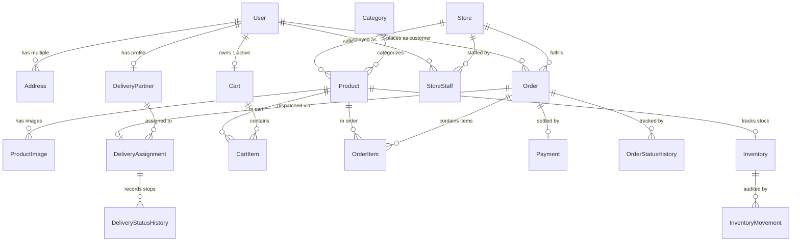

# 🗄️ Prerna Store — Database & System Design

## 1. Relational Schema Architecture
The Prerna Store database is powered by **PostgreSQL** and managed via **Prisma ORM**. The schema is designed for strict referential integrity, preventing dangling records, negative inventory quantities, and orphaned orders.



---

## 2. Model & Table Dictionary

### 2.1 `User`
- **Purpose**: Central identity record for all 4 roles (Customer, Shopkeeper, Delivery Partner, Admin).
- **Primary Key**: `id` (UUIDv4)
- **Important Fields**: `email` (Unique), `passwordHash` (Bcrypt), `name`, `phone`, `role` (Enum: `CUSTOMER`, `SHOPKEEPER`, `DELIVERY_PARTNER`, `ADMIN`), `isActive` (Boolean).
- **Relations**: Linked to `Address`, `Order`, `Cart`, `DeliveryPartner`, `StoreStaff`, and `AuditLog`.

### 2.2 `Store` & `StoreStaff`
- **Purpose**: Physical or dark-store fulfillment center providing local inventory within delivery radius.
- **Primary Key**: `id` (UUIDv4)
- **Important Fields**: `name`, `slug` (Unique), `address`, `city`, `rating`, `isActive`.
- **Role Isolation**: `StoreStaff` joins `User` and `Store` with roles `STORE_OWNER`, `STORE_MANAGER`, `STORE_CLERK`. A shopkeeper can only query and edit products belonging to their associated store.

### 2.3 `Category` & `Product`
- **Purpose**: Hierarchical grocery catalog structure.
- **Primary Key**: `id` (UUIDv4)
- **Fields**: `name`, `slug` (Unique), `description`, `price` (Float, selling price), `mrp` (Float, maximum retail price), `unit` (e.g. `1 kg`, `500 ml`), `sku` (Unique SKU identifier), `isActive`.
- **Integrity**: `price <= mrp` is enforced at service layer; cascading delete safeguards ensure products cannot be removed if historical orders exist.

### 2.4 `Inventory` & `InventoryMovement`
- **Purpose**: Exact real-time stock levels with double-entry audit logging.
- **Primary Key**: `id` (UUIDv4)
- **Fields**: `availableQty` (Int >= 0), `reservedQty` (Int >= 0), `lowStockThreshold` (Int).
- **Movement Types**: `RESTOCK` (merchant adds batch), `ORDER_RESERVED` (order placed), `ORDER_CANCELLED` (order aborted, stock refunded), `DAMAGE` (damaged goods written off).

### 2.5 `Cart` & `CartItem`
- **Purpose**: Server-persisted shopping basket that syncs seamlessly across devices and browser sessions.
- **Primary Key**: `id` (UUIDv4)
- **Constraints**: Compound Unique constraint on `[cartId, productId]` guarantees no duplicate product rows exist in the same cart (quantity increments instead).

### 2.6 `Order` & `OrderItem`
- **Purpose**: Financial agreement and fulfillment contract.
- **Primary Key**: `id` (UUIDv4)
- **Important Fields**: `orderNumber` (Unique formatted identifier e.g. `PRN-20261014-7263`), `subtotal`, `deliveryFee`, `tax`, `total`, `status` (Enum: 8-stage state machine), `paymentMethod`, `paymentStatus`.
- **Snapshot Immutability**: `OrderItem` stores copies of `productName` and `unitPrice` to ensure historical receipts never change even if current catalog prices are modified.

### 2.7 `DeliveryAssignment` & `DeliveryPartner`
- **Purpose**: Driver dispatching and real-time delivery lifecycle.
- **Statuses**: `PENDING`, `ASSIGNED`, `ACCEPTED`, `PICKED_UP`, `OUT_FOR_DELIVERY`, `DELIVERED`, `CANCELLED`.

---

## 3. Concurrency Protection & Transaction Integrity

Prerna Store safeguards against data corruption using atomic Prisma transactions:

```typescript
// Atomic Checkout Flow
await prisma.$transaction(async (tx) => {
  // 1. Fetch live stock for all cart items
  const inventory = await tx.inventory.findUnique({
    where: { productId: item.productId }
  });

  // 2. Guard against stock depletion
  if (inventory.availableQty < item.quantity) {
    throw new BadRequestException(`Insufficient stock for ${item.productName}`);
  }

  // 3. Atomically decrement available stock
  await tx.inventory.update({
    where: { productId: item.productId },
    data: {
      availableQty: { decrement: item.quantity },
      reservedQty: { increment: item.quantity }
    }
  });

  // 4. Create Order & OrderItems
  const order = await tx.order.create({ /* ... */ });

  // 5. Clear active customer cart
  await tx.cartItem.deleteMany({ where: { cartId: customerCart.id } });

  return order;
});
```
This guarantees that even under heavy concurrent load, stock levels never drop below zero.
