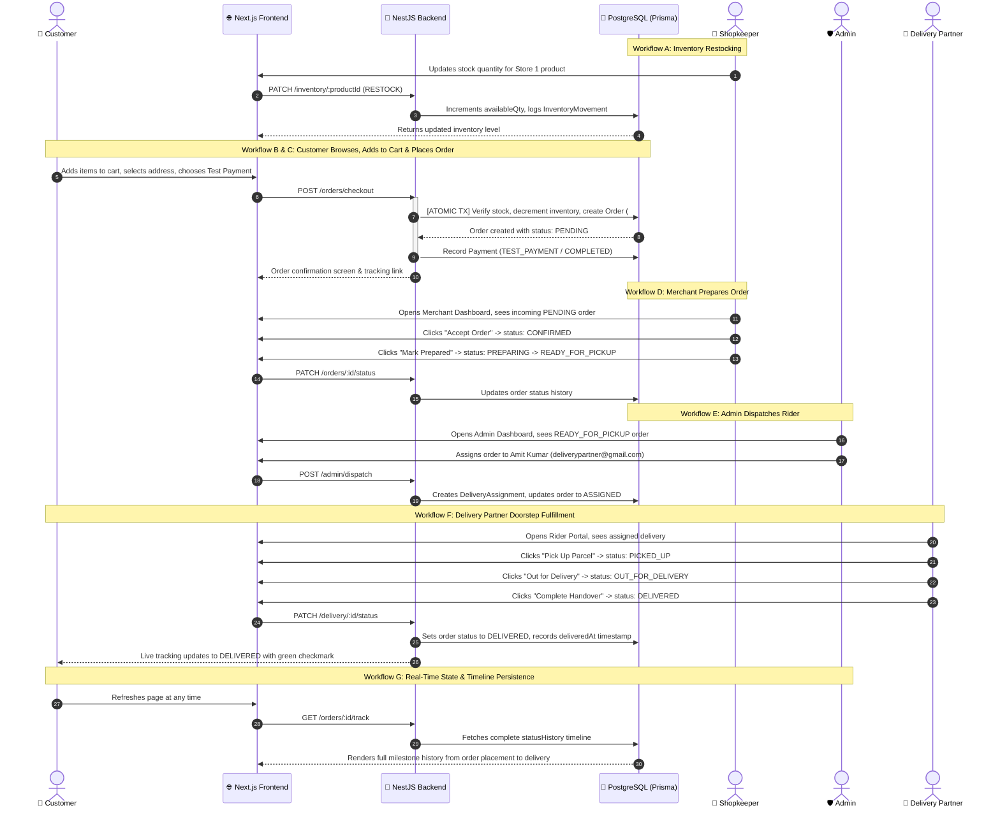

# 🔄 Prerna Store — End-to-End Business Workflows & Verification

## 1. End-to-End Business Lifecycle (Workflows A – G)

---

## 2. Automated Test Execution Evidence

All business paths and role access boundaries are validated with the automated test suite in [`scripts/test-e2e.ts`](file:///c:/Users/jaind/Projects/PRERNA/scripts/test-e2e.ts).

### Test Results Summary: **32 Passed, 0 Failed (100% Pass Rate)**

| Category | Test Case | Expected Behavior | Result | Evidence |
| :--- | :--- | :--- | :--- | :--- |
| **Auth & RBAC** | Customer Login | Valid credentials return JWT token and role `CUSTOMER` | **PASS** | Access token received |
| **Auth & RBAC** | Shopkeeper Login | Valid credentials return JWT token and role `SHOPKEEPER` | **PASS** | Access token received |
| **Auth & RBAC** | Delivery Partner Login | Valid credentials return JWT token and role `DELIVERY_PARTNER` | **PASS** | Access token received |
| **Auth & RBAC** | Admin Login | Valid credentials return JWT token and role `ADMIN` | **PASS** | Access token received |
| **Auth & RBAC** | Customer Admin Barrier | Customer calling `/admin/metrics` is rejected | **PASS** | HTTP 403 Forbidden |
| **Auth & RBAC** | Customer Merchant Barrier | Customer calling `/shopkeeper/dashboard` is rejected | **PASS** | HTTP 403 Forbidden |
| **Catalog** | Search `?q=milk` | Real search against PostgreSQL products table | **PASS** | 9 matching products |
| **Inventory** | Negative Stock Guard | Deducting stock below 0 must be rejected | **PASS** | HTTP 400 Bad Request |
| **Store Security** | Store Ownership Isolation | Shopkeeper 2 modifying Store 1 inventory is rejected | **PASS** | HTTP 403 Forbidden |
| **Cart** | Database-Backed Cart | Adding items persists to database cart across sessions | **PASS** | Calculated server-side |
| **Concurrency** | Race Condition on Stock | Two customers buying last 1 item simultaneously | **PASS** | 1 succeeds, 1 rejected, stock = 0 |
| **Order Machine** | Invalid State Jump | Jumping from `PENDING` directly to `DELIVERED` | **PASS** | HTTP 400 Bad Request |
| **Order Machine** | Merchant Progression | `PENDING` -> `CONFIRMED` -> `PREPARING` -> `READY` | **PASS** | Database transitions saved |
| **Dispatch** | Admin Rider Assignment | Order transitions to `ASSIGNED` with rider relation | **PASS** | Assignment created |
| **Delivery Guard** | Unassigned Rider Access | Rider B attempting to update Rider A's parcel | **PASS** | HTTP 403 Forbidden |
| **Delivery** | Doorstep Handover | Rider completes `PICKED_UP` -> `OUT_FOR_DELIVERY` -> `DELIVERED` | **PASS** | Final status DELIVERED |
| **Audit Logs** | Platform Auditing | Lifecycle events recorded in administrative audit log | **PASS** | Verified in DB |
